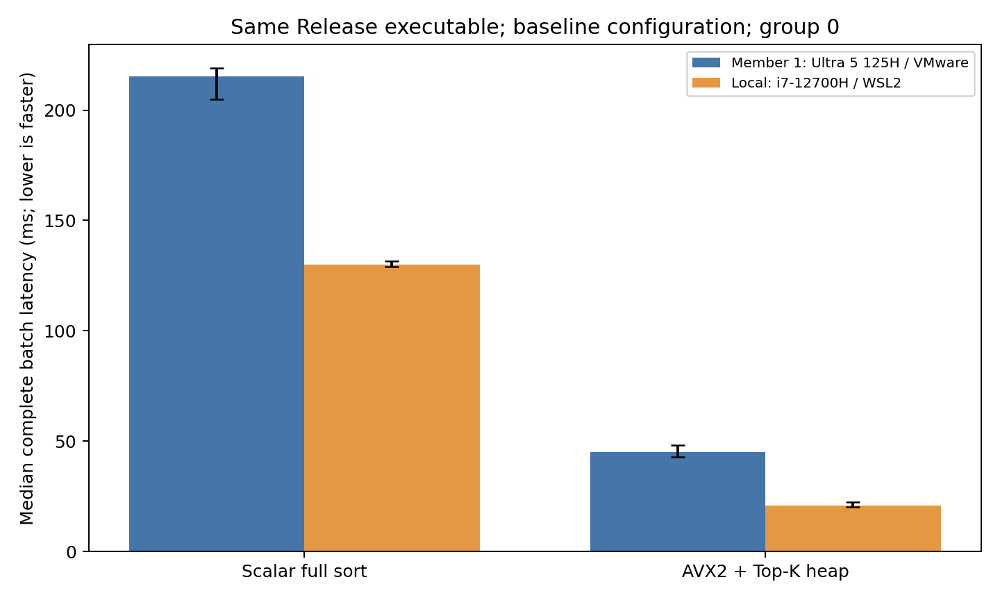

# CPU Experiment Comparison

Member 1: Core Ultra 5 125H / openEuler 24.03 / VMware. Local: i7-12700H / Ubuntu 26.04 / WSL2.

Both records use the original retained Release executable, identical input bits and matching measurement rules. The local executable SHA-256 matches Member 1's published artifact manifest.

Baseline: N=100000, d=64, q=16, k=10. Each value is the median of the 20 calls in group 0, matching the original report. There is no median across separate full experiments.

| Method | Member 1 (ms) | Local (ms) | Member 1 / local | Local time reduction |
|---|---:|---:|---:|---:|
| R0_scalar_full_sort | 215.247 | 129.874 | 1.657x | 39.7% |
| R1_avx2_topk_heap | 45.207 | 20.766 | 2.177x | 54.1% |

A ratio above 1 means the local batch completed faster. Error bars show Q1-Q3, not confidence intervals. The full 16 matched route/configuration records are in [comparison.csv](../results/i7_12700h_20261023/comparison.csv).

## Variability and interpretation

| Baseline method | Member 1 IQR / median | Local IQR / median |
|---|---:|---:|
| R0_scalar_full_sort | 6.6% | 2.0% |
| R1_avx2_topk_heap | 12.0% | 11.3% |

Both baseline AVX2 groups exceed the 10% variability threshold. Additional groups and raw samples are retained; no samples or slower groups are discarded. The ratios describe these recorded environments and are not pure CPU speed ratios or peak-hardware claims.

Both complete experiments pass the required correctness checks and record zero FP64 ID-position differences for the main configurations. Unit-test numerical-boundary differences are reported separately.

The original executable removes rebuilding differences. Operating systems, virtualization, dynamic libraries and physical-core mapping remain different. Host temperature, power conditions and background load were not jointly controlled.

Source revision: `063769a4d6b04f6f572aa01d119c3092e4e5577d`. Member 1 data: `CPU/results/main/`; local data: `CPU/results/i7_12700h_20261023/`.
