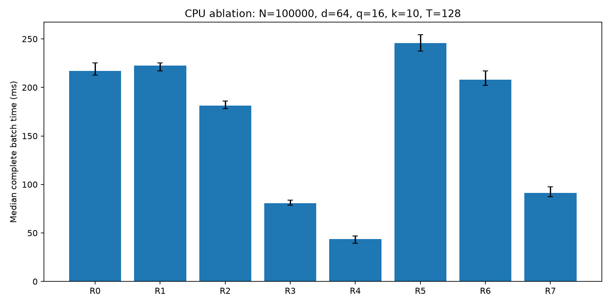
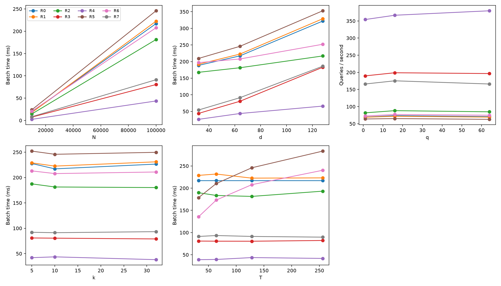
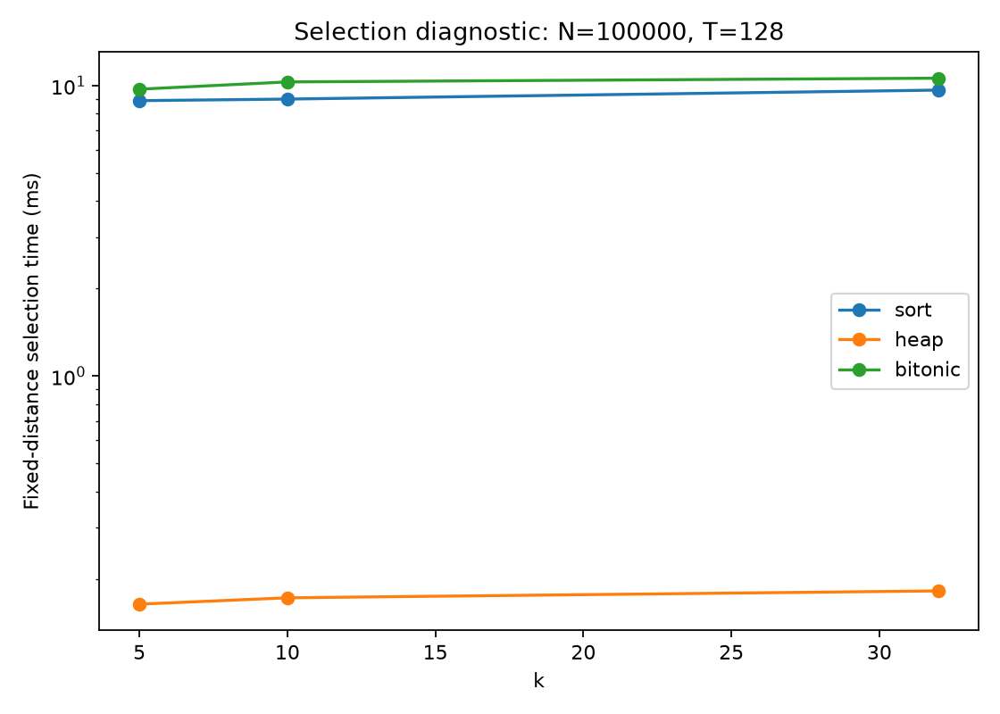

# Our CPU Exact kNN Search: Implementation and Evaluation

Date: 2026-10-09. We follow computation contract version 1.1 and execution rules version 1.1. Our conclusions refer to the retained source revision, compilation settings, input bit patterns, and raw measurements.

## 1. Scope

We implemented a single-threaded scalar full-sort baseline, an independent FP64 oracle, tiled scalar and AVX2 distances, max-heap selection, exact early abandonment, and a shared correctness framework. We also integrated a replaceable CPU Bitonic network and streaming merge. Our materials include experiments, plots, reproducibility commands, module interfaces, and a demonstration guide.

Our current measurements cover CPU execution. We have not measured GPU kernels, GPU GEMM, resident/transfer-inclusive latency, or CPU/GPU crossover points. The environment lacks NVIDIA tools and recorded GPU outputs. We provide independent validation tools for our later group GPU experiments.

## 2. Computation and implementation

X and Q contain row-contiguous FP32 components that are finite and within [-1,1]. Labels are int32; database row IDs are uint32. For every query, we return exactly k distinct valid IDs, complete squared Euclidean distances, and original labels. Ordering uses actual distance, then smaller ID for exact ties. Tolerance never participates in comparison. Padding uses positive infinity and UINT32_MAX; output zero is normalised to positive zero.

| Route | Distance calculation | Selection |
|---|---|---|
| R0 | Scalar, complete evaluation | Full sort |
| R1 | Tiled scalar | Full sort |
| R2 | Tiled AVX2 | Full sort |
| R3 | Tiled scalar | Max-heap |
| R4 | Tiled AVX2 | Max-heap |
| R5 | Tiled scalar | Bitonic and streaming merge |
| R6 | Tiled AVX2 | Bitonic and streaming merge |
| R7 | Matching scalar rule with early abandonment | Max-heap |

Scalar subtraction, squaring, and accumulation are FP32 operations in increasing dimension order. AVX2 maintains eight lane partial sums, reduces lanes in order, and then handles remaining dimensions with scalar operations. Unaligned loads cover only valid dimensions. We reset candidate state for every query.

For a partial tile, we calculate distances only for valid samples, fill the remainder with invalid candidates, and run the Bitonic network. We retain min(k, valid_count); k>T retains every valid item in that tile. We merge two ordered candidate lists into their first k entries. Full sort uses O(N) candidate storage, the streaming heap uses O(k), and Bitonic uses one T-entry tile and two lists of at most k entries.

Our Release build disables fast-math and FMA contraction. We disable automatic vectorisation in scalar, oracle, and SIMD source files, retaining explicit AVX2 intrinsics only in the SIMD file. We use round-to-nearest and disable FTZ/DAZ. Recorded disassembly contains scalar subss/mulss/addss and AVX2 vsubps/vmulps/vaddps, with no FMA. See `results/instruction_checks.json` and the instruction listings.

Early abandonment uses only the matching scalar heap rule. Once the heap is full, we discard a candidate only when its partial distance is strictly greater than the current worst distance tau. Equality continues. Non-negative terms make the partial sum monotone under the same controlled FP32 accumulation order. Unpruned candidates produce complete distances; partial distances are never returned. We do not use a scalar partial sum to prune a different SIMD reduction.

Full sort requires O(qNd + qN log N) work. Heap selection has worst-case O(qNd + qN log k + qk log k) work. Full Bitonic networks require O(q ceil(N/T) T log^2 T) selection work, with streaming merge costing up to O(q ceil(N/T) k); distance calculation remains O(qNd). These work bounds do not measure memory traffic.

## 3. Correctness

Our Release, ASan/UBSan, and clean-build checks passed 286 cases and 11,350 assertions. Cases cover each tile size, partial tiles, AVX2 tails, zero/identical/duplicate vectors, exact and near ties, k=1, k=N, k>T, invalid inputs, multiple queries, repeated and alternating calls, and partial distances equal to or greater than tau. Fixed-distance sort, heap, and Bitonic tests require identical IDs and order.

Our independent oracle promotes the actual FP32 inputs to FP64, calculates every distance, and sorts without calling production distance or selection kernels. We use atol=1e-5 and rtol=1e-4, requiring absolute error <= atol + rtol * abs(reference). We check all calculated sample distances. Structure, labels, order, fixed-distance selection, distance tolerance, FP64 IDs, and repeat determinism are separate fields. Python independently checks the exported fixture rankings. The external verifier passes a valid-output test and five injected-failure tests.

The boundary tests contain 64 FP64 ID-position differences from our deliberately constructed `fixture_1`, counted across queries and eight routes. Its first sample has one component nextafter(0.5,1), with other components 0.5 and a zero query. Its FP64 distance is approximately 2.250000059604648, while other samples have distance 2.25. FP32 rounds those distances to 2.25 and applies the smaller-ID rule, admitting ID 0 earlier. The distance tolerance and fixed-distance selection pass, but FP64 IDs differ. We classify this as an explained numerical boundary difference, rather than strict agreement.

Our main experiment contains 88 route/configuration validation records. All required structure, label, order, fixed-distance selection, tolerance, and repeat checks pass. There are 0 FP64 ID-position differences; the maximum absolute error across complete distance checks is 7.85854889e-05. See `results/main/correctness.csv`. The baseline R4 output and complete distance table also pass our independent Python verifier; results exported by a clean build agree with the original build.

## 4. Experimental method

Our VMware/openEuler x86_64 guest reports an Intel Core Ultra 5 125H, two vCPUs, and AVX2 support. We use one computation thread, bound to guest vCPU 1 with affinity verified. This does not establish a fixed host physical core. Host frequency, P/E core type, and power mode are not observable. We recorded GCC 12.3.1 and CMake 3.27.9; Compiler, Python, NumPy, and Matplotlib versions are listed in `results/environment_summary.json`.

Our synthetic-v1 generator uses the standard 32-bit MT19937 sequence with seed 5206. We take the high 24 bits, divide by 2^24, and map to [-1,1). Each configuration resets the seed and generates X followed by Q in row order. Labels are ID modulo 10. All routes within a configuration share identical input. We retain little-endian bit patterns and SHA-256 identifiers.

The explicit single-factor list contains 11 configurations: a baseline plus 1 + 2 + 2 + 2 + 3 changes. We retain all specified values.

| Case | N | d | q | k | T |
|---|---|---|---|---|---|
| 0 | 100000 | 64 | 16 | 10 | 128 |
| 1 | 10000 | 64 | 16 | 10 | 128 |
| 2 | 100000 | 32 | 16 | 10 | 128 |
| 3 | 100000 | 128 | 16 | 10 | 128 |
| 4 | 100000 | 64 | 1 | 10 | 128 |
| 5 | 100000 | 64 | 64 | 10 | 128 |
| 6 | 100000 | 64 | 16 | 5 | 128 |
| 7 | 100000 | 64 | 16 | 32 | 128 |
| 8 | 100000 | 64 | 16 | 10 | 32 |
| 9 | 100000 | 64 | 16 | 10 | 64 |
| 10 | 100000 | 64 | 16 | 10 | 256 |

Complete-search timing begins with required state reset and ends when sorted IDs, distances, and labels are ready. It includes distance calculation, candidate management, local selection, merge, final ordering, and label gathering. It excludes full input validation, generation, I/O, the oracle, correctness checks, and initial reusable allocation. Ordinary calls still validate input; steady-state timing uses prevalidated immutable input.

Each route receives 10 warm-up calls and 20 measured calls. We alternate forward and reverse route order by round. Quartiles use linear interpolation at position 19*p. We mark IQR/median >10% as variable and perform at most one extra group for that configuration, retaining both groups. Our dataset includes 3,400 complete-search timing records and 660 fixed-distance selection timing records. There are 76 variable group/route records, including 37 variable records in the repeated groups. We do not give definitive performance rankings for persistently variable configurations.

We collect stages and abandonment counters outside the formal timing calls. Sort routes allow distance, sort, and output diagnostics; heap and Bitonic routes report combined times. Stage diagnostics are single additional runs, not measurements to add to the complete-search median. Fixed-distance selection uses the same scalar distances and preallocated buffers, includes necessary reset/copy work, and receives its own 10 warm-ups and 20 measurements.

## 5. Baseline CPU results

N=100000, d=64, q=16, k=10, T=128. Times are complete batch latency in milliseconds. Auxiliary bytes measure peak live workspace allocation capacity for one route, excluding input, output, the oracle, other routes' buffers, and full sort's O(log N) stack space.

| Route | Initial median (ms) | Initial IQR/median | Repeat median (ms) | Auxiliary bytes |
|---|---:|---:|---:|---:|
| R0_scalar_sort | 217.121 | 5.8% | 226.176 | 800000 |
| R1_tiled_scalar_sort | 222.554 | 3.7% | 224.546 | 800000 |
| R2_avx2_sort | 181.398 | 4.2% | 188.479 | 800000 |
| R3_scalar_heap | 80.476 | 6.3% | 81.809 | 80 |
| R4_avx2_heap | 43.639 | 17.2% | 46.226 | 80 |
| R5_scalar_bitonic | 245.856 | 7.0% | 248.093 | 1184 |
| R6_avx2_bitonic | 207.800 | 7.1% | 214.686 | 1184 |
| R7_early_heap | 91.271 | 10.9% | 94.884 | 80 |

R0 to R1 isolates tiling; R1 to R2 isolates SIMD. R1/R3/R5 and R2/R4/R6 compare selection. The initial R0/R4 median ratio is 4.975. This is a ratio of observed virtual-machine medians, subject to variability; it is not a definitive ranking or a physical-hardware peak claim. Full-sort selection can mask arithmetic savings, while the heap reduces candidate storage and maintenance work.

R7 evaluates an average of 36.961 of 64 dimensions and abandons 99.90% of candidates. The initial R3/R7 median ratio is 0.882. A high abandonment fraction is not the same as an equal arithmetic saving: candidates can exceed tau only after many dimensions, and threshold checks add overhead. We interpret the timings and dimension counts together, rather than attributing the entire R0/R7 ratio to abandonment.

## 6. Parameter scans and selection diagnostics

At the baseline, the initial and repeated R1/R0 ratios are approximately 1.025 and 0.993, so these samples show no stable tiling benefit. R1/R2 ratios are approximately 1.227 and 1.191: SIMD savings appear in complete full-sort time, but sorting still matters. A separate R0 stage run records about 95.3 ms for distance calculation and 157.4 ms for sorting; we do not sum those diagnostic times to replace a formal median.

Initial R4 medians at d=32/64/128 are approximately 26.1/43.6/66.0 ms. At N=10000/100000 they are approximately 2.46/43.64 ms. The observed scaling is not simply proportional, and does not establish a physical cache or bandwidth bottleneck. We process CPU queries sequentially. Throughput at q=1/16/64 is approximately 354/367/380 queries/s, with variability limiting conclusions about batching.

Larger Bitonic tiles increase log^2 T network work but reduce tile and merge counts. Initial R6 medians at T=32/128/256 are approximately 135/208/239 ms. These observations do not establish the best tile size for other k values or for GPUs. Heap k/T point estimates change less, but remain variable. Our k=5/10/32 range does not establish a stable crossover threshold; the heap is a candidate for subsequent deployment validation, rather than a definitive choice under these variable measurements.

We do not remeasure R0 during the additional T scan: its identical baseline configuration supplies the horizontal comparison. Throughput is q divided by median batch time. Batch time divided by q is amortised cost, not individual-query response latency. Different parameter configurations may generate different queries; routes within one configuration share identical data.

For fixed scalar distances, N=100000, T=128, and one query:

| k | Selection | Median (ms) | IQR/median |
|---|---|---:|---:|
| 5 | sort | 8.8730 | 17.9% |
| 5 | heap | 0.1638 | 68.4% |
| 5 | bitonic | 9.7169 | 24.6% |
| 10 | sort | 8.9840 | 21.0% |
| 10 | heap | 0.1722 | 30.7% |
| 10 | bitonic | 10.2937 | 10.9% |
| 32 | sort | 9.6485 | 36.1% |
| 32 | heap | 0.1819 | 71.6% |
| 32 | bitonic | 10.6031 | 27.5% |

We use complete search, fixed-distance diagnostics, and workspace size together. We cannot infer crossover behaviour near k=N from k=5/10/32. Warm steady-state data does not establish physical cache-capacity effects or measured memory bandwidth. We retain variable data and refrain from definitive rankings.

## 7. Memory and reproducibility

Our measured candidate size is 8 bytes. At the baseline, full-sort workspace is 800000 bytes, heap workspace is 80 bytes, and Bitonic workspace is 1184 bytes: T=128 candidates plus two k=10 lists. Input and output capacity totals and preparation time are recorded separately in `summary.csv`. The benchmark retains several route workspaces and the oracle at once; whole-process RSS is not one algorithm's auxiliary storage.

The public environment summary records the guest operating system, reported CPU, compiler, and experiment settings. Process snapshots, `/proc` contents, local build paths, and host-specific details are excluded from this GitHub copy. Compiled targets are provided under `artifacts/`; CMake caches and generated build-system files are omitted.

The [README](../CPU_Guide.md) provides build, test, run, and plotting commands. We retain compiler flags, the compact environment summary, complete generated input arrays, their hashes, original timing repetitions, statistics, small shared fixtures, compiled artifacts, and plotting scripts. The seed and generator definition allow us to regenerate and verify the data.

## 8. Limitations and next experiments

We have completed our CPU implementation, correctness checks, experiments, and supporting materials in this environment. Our group still needs actual GPU outputs, hardware/configuration records, GEMM settings, and transfer measurements. Our independent verifier supports the later GPU correctness and boundary analysis needed for CPU/GPU crossover conclusions.

Additional FMA experiments, SIMD early abandonment, an automatic dispatcher, approximate indexing, multiple GPUs, and out-of-core double buffering are outside these CPU conclusions. Original Chinese documents remain available for reference.
