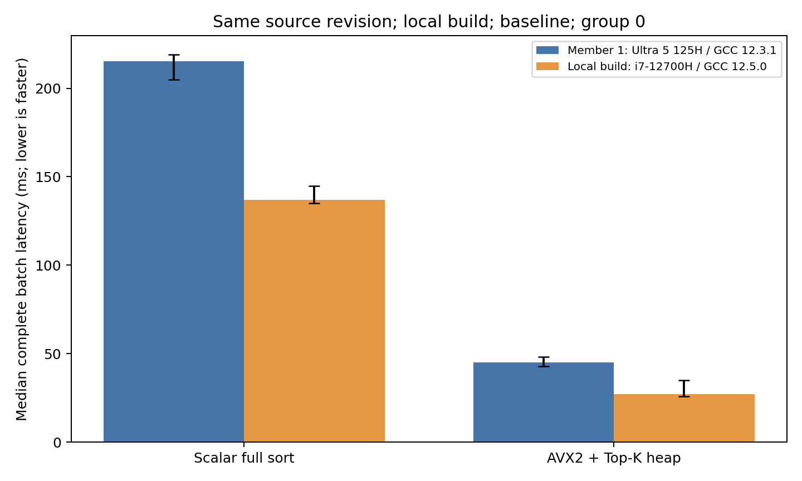

# Local-Build CPU Comparison with Member 1

Baseline: N=100000, d=64, q=16, k=10. Medians use 20 samples from group 0, matching the original report. No aggregation across complete experiments.

| Method | Member 1 (ms) | Local build (ms) | Member 1 / local build | Local time reduction |
|---|---:|---:|---:|---:|
| R0_scalar_full_sort | 215.247 | 137.031 | 1.571x | 36.3% |
| R1_avx2_topk_heap | 45.207 | 27.189 | 1.663x | 39.9% |

A ratio above 1 means the local batch completed faster. Error bars show Q1-Q3, not confidence intervals. All 16 matched parameter/route records and variability flags are retained in [comparison.csv](../results/comparison.csv).

| Baseline method | Member 1 IQR / median | Local IQR / median |
|---|---:|---:|
| R0_scalar_full_sort | 6.6% | 7.3% |
| R1_avx2_topk_heap | 12.0% | 34.0% |

The source revision and controlled compiler options match. The executables are independently built: Member 1 used GCC 12.3.1 on openEuler/VMware; this run used GCC 12.5.0 on Ubuntu/WSL2. CPU, compiler minor version, system, virtualization and dynamic libraries differ, so the ratios are not isolated CPU speed ratios.

All main correctness checks pass on both machines. All input hashes match. Variable groups and additional groups are retained; no slower groups or individual samples are removed.

Member 1 reference: `CPU/results/main/`; local data: `CPU_i7_12700H_LocalBuild/results/main/`.
