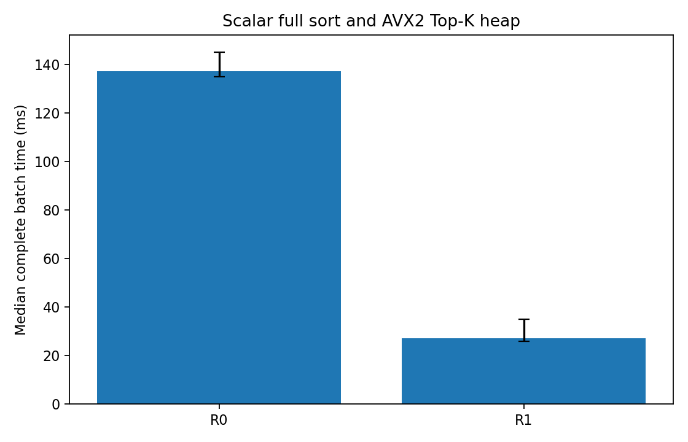
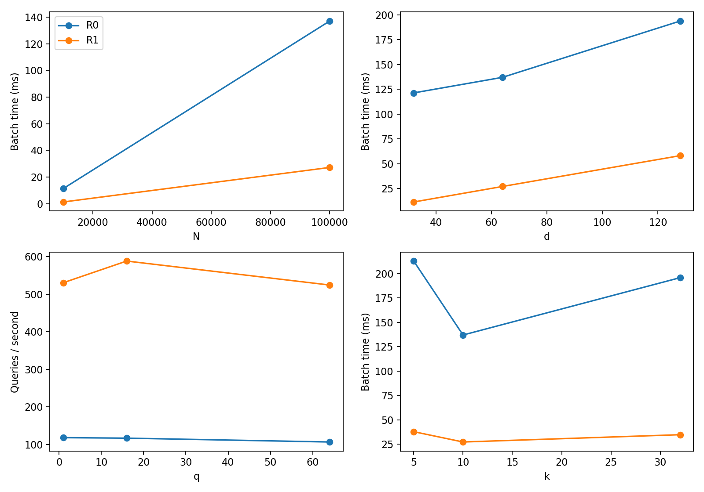

# Required CPU kNN Implementation: Results

Date: 2026-10-23. This report covers only the required CPU work: scalar full sort with an independent FP64 oracle, AVX2 distance calculation with a Top-K heap, and one candidate-list merge method. Results refer to the retained source, build flags, input hashes, and raw records.

This experiment builds Member 1's unchanged source code locally and follows the original procedure for one main experiment, without additional repetitions of the full experiment.

Build: GCC 12.5.0, Release. Platform: i7-12700H, Ubuntu 26.04 / WSL2.

## Methods

R0 computes all scalar FP32 squared distances, stores N candidates, and sorts by distance then ID. R1 computes FP32 distances with AVX2 eight-lane accumulation and a scalar tail, maintaining a max-heap of at most k candidates and sorting the retained output. The candidate merge helper combines two ordered lists up to k entries; an independent unit test compares it with a full sort of the concatenated inputs.

The oracle promotes the actual FP32 inputs to FP64, computes complete distances independently, and sorts by distance then ID. Correctness records separately report structure, labels, output ordering, fixed-distance selection, distance tolerance, FP64 ID agreement, and repeat determinism. The distance criterion is atol=1e-5 and rtol=1e-4. All required structural, selection, tolerance, and determinism fields pass: **True**. There are 0 FP64 ID-position differences across 16 route/configuration records; the maximum recorded absolute distance error is 7.85854889e-05. Near-boundary ID differences are reported separately from selection correctness.

## Experimental setup

The baseline is N=100000, d=64, q=16, k=10. The eight configurations vary N, d, q, and k one factor at a time. Inputs use synthetic-v1, MT19937 seed 5206, X followed by Q, and labels equal to ID modulo 10. Input shapes and SHA-256 hashes are retained under `results/main/`; the identical arrays are reused from [Member 1's shared dataset](../../CPU/results/main/).

Each route receives 10 warm-ups and 20 timed complete-search calls per group. Timing includes per-query state reset, distance computation, candidate selection, final ordering, and label gathering. It excludes input generation, full validation, I/O, oracle work, correctness checks, and initial reusable allocation. Routes alternate order each round. The guest CPU affinity, compact environment, compiler settings, and source instructions are recorded alongside the results.

## Baseline performance

Times are complete batch latency in milliseconds. Auxiliary bytes report route workspace capacity, excluding input, output, and the oracle.

| Route | Median (ms) | IQR / median | Auxiliary bytes |
|---|---:|---:|---:|
| R0_scalar_full_sort | 137.031 | 7.3% | 800000 |
| R1_avx2_topk_heap | 27.189 | 34.0% | 80 |

The observed scalar-full-sort to AVX2-heap median ratio is **5.040x** on this guest. This is a measurement for the recorded virtual machine and inputs. It does not establish physical-host performance. There are 13 variable route/group records with IQR/median above 10%; consult the raw records before making broader performance claims.

## Parameter configurations

| Case | N | d | q | k |
|---|---:|---:|---:|---:|
| 0 | 100000 | 64 | 16 | 10 |
| 1 | 10000 | 64 | 16 | 10 |
| 2 | 100000 | 32 | 16 | 10 |
| 3 | 100000 | 128 | 16 | 10 |
| 4 | 100000 | 64 | 1 | 10 |
| 5 | 100000 | 64 | 64 | 10 |
| 6 | 100000 | 64 | 16 | 5 |
| 7 | 100000 | 64 | 16 | 32 |

## Reproduction

Build and validate using [build.md](build.md). Run `knn_bench` into a fresh result directory, then run `scripts/analyze.py` and `scripts/report.py` against that directory. The main data, hashes, raw timing records, correctness records, and generated plots are retained under `results/main/`.
