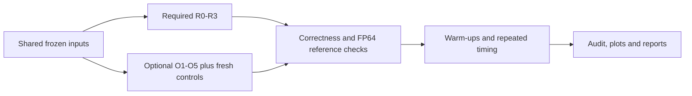

# CEG5206 Group 6 — Exact kNN on CPUs and GPUs

This project compares CPU and CUDA implementations of exact k-nearest-neighbour search. Each route searches the database and returns the nearest `k` results, ordered by squared Euclidean distance and then sample ID, with their original labels.

This repository contains the required and optional CPU/GPU implementations, their tests, and retained experiment records.

## Required implementations

| Route | Implementation |
|---|---|
| R0 — CPU baseline | Scalar FP32 distance computation and full sorting |
| R1 — CPU optimisation | AVX2 SIMD distance computation and a Top-K max-heap |
| R2 — CUDA baseline | Materialised distance table and CUB segmented radix full sorting |
| R3 — CUDA optimisation | Fused tiled distance computation, local Bitonic selection and hierarchical candidate merging |

An independent **FP64 oracle** checks numerical accuracy and neighbour IDs. Candidate merging is also tested against concatenation followed by full sorting. CUDA routes support both thread-per-vector and warp-per-vector distance mappings.

R3 requires `k <= 128` and `k <= tile`, with tile sizes 32, 64, 128 or 256.
The default tile is 128. R0/R1 support `1 <= k <= N`; R2 supports this range
subject to its allocation and CUB size limits. These route limits are separate
from the smaller k values used in the retained experiment grid.

All five optional methods are also implemented: CPU AVX2 tiled Bitonic,
CUDA radix selection with exclusive scan/compaction, a cuBLAS GEMM reference,
scalar early abandonment, and single/double-buffered out-of-core streaming.
They use a separate experiment so their records stay distinct from the required
R0–R3 comparison.

## Pipeline workflow



## Run the required study

Complete [setup](#setup-on-another-machine) first. These Python entrypoints
work with a configured CUDA toolkit and do not require the original machine's
project-local toolkit directory.

```bash
# Preview without compiling, testing or measuring.
.venv/bin/python experiments/run_full_experiment.py --repo-root . --dry-run

# Build, correctness tests, sanitizers and a small integration experiment.
.venv/bin/python experiments/run_full_experiment.py --repo-root . --smoke

# Full eight-case experiment; creates the inputs reused by the optional study.
.venv/bin/python experiments/run_full_experiment.py --repo-root . \
  --clean-build --results-dir results/new_required_run

# Optional: three separate sessions and a repeatability report.
.venv/bin/python experiments/run_full_experiment.py --repo-root . \
  --sessions 3 --clean-build --results-dir results/new_required_study
```

Use AC power and consistent power settings; close unrelated workloads.
`--results-dir` must be new or empty. Without it, the driver creates a new
UTC-timestamped directory. Every run retains its own records and build output
is regenerated automatically.

## Run all optional methods

Reuse the exact CPU-exported inputs from a completed required run. For the
full-run command above, that directory is `results/new_required_run/cpu_core`.
The retained October run's generated arrays are not included in its Git
snapshot, so a fresh checkout should first run the required study or retrieve
matching arrays before using it as optional input.

```bash
# Preview all optional routes without running them.
.venv/bin/python experiments/run_optional_experiment.py --repo-root . --dry-run

# Build and validate without collecting timing samples.
.venv/bin/python experiments/run_optional_experiment.py --repo-root . \
  --inputs results/new_required_run/cpu_core --validate-only

# Short integration measurement, with fresh correctness/sanitizer gates.
.venv/bin/python experiments/run_optional_experiment.py --repo-root . \
  --inputs results/new_required_run/cpu_core --smoke

# Full optional study with contemporaneous CPU/GPU controls.
.venv/bin/python experiments/run_optional_experiment.py --repo-root . \
  --inputs results/new_required_run/cpu_core --clean-build
```

Optional results go to `results/optional_runs/<timestamp>/`. Start with
`analysis/optional_results.md`; it includes raw-data validation, controlled
speedups, CPU dimension counts, GEMM/radix stages, buffer allocation and
streaming comparisons. Raw CSVs and test/sanitizer logs are retained. Required
and optional performance records are never silently combined.

| Optional method | Implementation and correctness control |
|---|---|
| CPU Bitonic | AVX2 distances, scalar local Bitonic networks, packed candidate lists and hierarchical merges; bitwise comparison with R1 |
| Early abandonment | Scalar partial-sum pruning only when `sum > threshold`; same heap path with full evaluation (C0) supplies the timing control |
| Radix + scan | Eight histogram threshold refinements, self-written hierarchical exclusive Blelloch scan, compaction, and sorting only the retained k; exact same-mapping R2 comparison |
| GEMM reference | Labelled cuBLAS pedantic FP32 GEMM, separate norm/reconstruction costs and near-zero direct rechecks; full-sort validation of its own distances |
| Out-of-core | One/two pinned host/device chunk slots, asynchronous H2D and one compute stream, global-ID candidate merging; single/double/R2 agreement |

The GEMM reference requires cuBLAS. When recreating the minimal project-local
CUDA 12.8 toolkit, install the pinned cuBLAS 12.8.4.1 shared libraries with:

```bash
.venv/bin/python experiments/install_optional_cublas.py
```

This downloads NVIDIA's official approximately 939 MB archive, verifies its
SHA-256 and installs headers/shared libraries under the ignored `.tools/`
directory. A normal complete CUDA 12.x installation can supply cuBLAS directly.

`--mapping thread|warp`, `--tile 32|64|128|256`, and `--chunk-size <rows>`
control the optional study. Streaming always includes transfers and host label
gathering; it has no resident-only timing. The overlap ratio is a service-time
estimate, not a profiler trace. Its device allocation depends on the chunk
budget, while the complete input must fit host RAM. To measure inputs larger
than available device memory, supply their input manifest and arrays and use:

```bash
.venv/bin/python experiments/run_optional_experiment.py --repo-root . \
  --inputs /path/to/cpu-export --stream-only --chunk-size 32768
```

Stream-only mode avoids materialised full-N GPU controls. A small chunk-budget
run validates bounded-memory processing; it does not by itself prove that the
tested dataset exceeded physical GPU memory. CUDA optional routes support
`k <= 128`, with streaming additionally requiring `k <= tile`; CPU Bitonic
supports `k=N`, including k larger than one tile.

The optional implementation has build/unit/sanitizer evidence under
`results/optional_validation/` and a completed experiment linked below. The
required and optional experiments retain their own source hashes and records.

## Setup on another machine

The supported build and measurement environment is Linux with GCC and
CUDA 12.x. Native Windows/MSVC builds are not supported by the current
compiler flags and shell commands. Windows users should use a Linux
environment with working CUDA access for the full experiment; the offline
Python workflow tests can run on Windows.

Use an x86 CPU with AVX2, a C++17 compiler, CMake 3.21 or later, Python 3,
and a CUDA 12.x toolkit with Compute Sanitizer. The current drivers target
the GTX 1050 (`sm_61`). CUDA 13 cannot compile this Pascal target. The CUDA
version shown by `nvidia-smi` is driver capability, separate from the installed
compiler.

Put `nvcc` and `compute-sanitizer` on PATH and make the CUDA runtime available
to the dynamic linker. The optional build also needs cuBLAS headers and shared
libraries; a complete CUDA toolkit can provide them directly. Then create the
Python environment:

```bash
python3 -m venv .venv
.venv/bin/python -m pip install -r experiments/requirements.txt
```

Use the Python commands above for required and optional experiments. The
shell wrapper `run_experiment.sh` is a convenience for a checkout with its own
`.tools/cuda-12.8/` and `.venv/`; it selects those local dependencies. In such a
checkout, `./run_experiment.sh --clean-build` runs the required study and
`./run_experiment.sh --optional --inputs <CPU_RESULTS> --clean-build` runs the
optional study. Local dependencies and rebuildable output are ignored by Git.

## Measurement and validation

The driver builds CPU/GPU modules and requires actual CPU/GPU test execution,
then runs memcheck and racecheck before measurement. The full grid varies
N, d, q and k one factor at a time. GPU mappings and four tile sizes are
measured in separate baseline ablations. Default measurements use ten
warm-ups and twenty timed calls; extra CPU timing groups are retained.

GPU-resident CUDA-event latency and transfer-inclusive host wall time are
reported separately. R3 distance and local Bitonic selection are timed as a
combined stage. Source hashes, compiler flags, versions, hardware metadata,
correctness records, raw samples and allocated-buffer accounting are retained.
The full-run audit checks input hashes, statistics, stages and plots.

Exact selection follows each route's declared FP32 arithmetic and the
(distance, ID) tie order. Numerical tolerance is
`abs(d32-d64) <= 1e-5 + 1e-4*abs(d64)`. FP64 ID differences are reported
separately; near ties can differ after FP32 rounding. Same-mapping R2/R3
results must match IDs, distance bits and labels exactly.

Both CPU and GPU groups with IQR/median above 10% are flagged. Headline CPU
comparisons use the predeclared group 0, with other groups retained. R0/R1
measures SIMD and heap selection together, not SIMD alone. Temporary buffer
allocation is not a measurement of DRAM traffic. The fastest measured tile
is specific to the tested workload and machine.

With multiple sessions, the first mapping is frozen throughout the study;
input/source hashes and hardware/configuration must match. Sanitizer evidence
is reused only within that unchanged study; tests and audits run per session.
The summary uses paired per-session speedups and ranges of session medians,
not pooled samples or confidence intervals. Consecutive sessions do not
establish statistical independence.

## Results

The retained full experiment was completed on **26 October 2026**:

- [Results report and figures](results/runs/20261026T070351075233Z/analysis/final_results.md)
- [CPU/GPU correctness records](results/runs/20261026T070351075233Z/analysis/unified_correctness.csv)
- [Hardware, software and run metadata](results/runs/20261026T070351075233Z/environment.json)
- [Raw data and validation logs](results/runs/20261026T070351075233Z/)
- [Results index and data-retention notes](results/README.md)

The retained records contain 16 passing CPU and 25 passing GPU correctness records. GPU tests passed 44 cases and 2,294 checks; Compute Sanitizer reported no memory errors or race hazards.

GPU-resident and transfer-inclusive timings are reported separately. This is **one completed measurement session**; a three-session repeatability study has not been completed. Near-tie FP64 ranking differences are recorded separately from FP32 selection correctness.

The optional experiment was completed on **11 November 2026**, with 88 passing
correctness records, 2,400 timing samples across 120 groups, and zero recorded
FP64 ID-position differences:

- [Optional results report and figures](results/optional_runs/20261111T062816975198Z/analysis/optional_results.md)
- [Optional correctness records](results/optional_runs/20261111T062816975198Z/measurements/correctness.csv)
- [Optional run metadata](results/optional_runs/20261111T062816975198Z/environment.json)
- [Optional raw data and validation logs](results/optional_runs/20261111T062816975198Z/)

This is one optional measurement session. Streaming was measured with bounded
chunks; these records do not establish that the input exceeded physical VRAM.

New outputs are written to:

- `results/smoke_runs/<timestamp>/`: smoke integration reports.
- `results/runs/<timestamp>/`: one full session.
- `results/studies/<timestamp>/`: repeated sessions and `study_summary.md`.
- `results/optional_runs/<timestamp>/`: optional methods and contemporaneous controls.

Each full session contains `environment.json`, `source_sha256.json`,
`logs/`, CPU/GPU raw-data directories, and `analysis/` with the results report,
eight plots, unified CSVs and `data_audit.json`. On failure, inspect
`environment.json` and `logs/workflow.log`, then rerun into a new directory.
Incomplete or incompatible sessions cannot enter the study summary.

Generated binary arrays from new required/optional runs are ignored by Git;
their shapes, generator seed and SHA-256 hashes are retained. A fresh checkout
must regenerate or retrieve the matching arrays before auditing their hashes.
Reproducing the study creates arrays in its new results directory. The earlier
CPU experiment folders separately retain historical inputs and artifacts.

```bash
# Audit the retained local inputs and records without measuring again.
.venv/bin/python experiments/verify_experiments.py \
  --results results/full --output /tmp/knn-data-audit.json

# Regenerate a completed repeated-study summary.
.venv/bin/python experiments/summarize_sessions.py --study results/my-study

# Offline workflow tests; no CPU/GPU benchmark execution.
.venv/bin/python -m unittest discover -s experiments/tests -v
```

## Repository guide

| Location | Contents |
|---|---|
| [CPU/](CPU/) | Required and optional CPU routes, FP64 oracle and tests |
| [GPU/](GPU/) | Required/optional CUDA routes, candidate merging and tests |
| [experiments/](experiments/) | Experiment runner, analysis, report generation and data auditing |
| [docs/](docs/README.md) | Documentation index, English CPU comparison and proposal history |
| [docs/EXPERIMENT_PROTOCOL.md](docs/EXPERIMENT_PROTOCOL.md) | Workloads, correctness checks, timing boundaries and experiment design |
| [KNN_STUDY.md](KNN_STUDY.md) | Detailed setup, reproduction and reporting instructions |
| [results/](results/) | Required and optional experiment records and evidence |

## Earlier CPU experiments

The following folders preserve earlier i7-12700H experiments separately from the current CPU/GPU comparison:

- [Original Release executable experiment](CPU_i7_12700H_OriginalRelease/)
- [Local source-build experiment](CPU_i7_12700H_LocalBuild/)
- [Comparison of the three earlier CPU experiments](docs/CPU_Experiment_Comparison.docx)

The three earlier CPU records compare execution environments and build
provenance. They do not count as three repeated sessions of the current
CPU/GPU study. Current CPU/GPU speedups use their recorded same-machine
controls; the historical CPU results remain separate evidence.

`CPU_i7_12700H_LocalBuild/` preserves the source, Release binaries and results
from **23 October 2026**, at source revision
`063769a4d6b04f6f572aa01d119c3092e4e5577d`. Its source is kept as a complete
historical snapshot for reproducing that local rebuild; later additions to
the current `CPU/` module are not copied into it. Some source files therefore
appear in both folders intentionally. The historical experiment reuses the
arrays under `CPU/results/main/` through its recorded input locations and
hashes. See its [snapshot notes](CPU_i7_12700H_LocalBuild/README.md#historical-experiment-snapshot).

## Design and reporting

The [experiment protocol](docs/EXPERIMENT_PROTOCOL.md) specifies the grid,
correctness gates, timing boundaries and work/storage hypotheses. The
[CPU guide](CPU/CPU_Guide.md) describes the standalone CPU build and merge API.
Original and revised proposals are in [docs/proposals/](docs/proposals/).

Use your generated report to explain complete latency, stage costs,
transfer overhead, candidate-buffer storage and tile/merge trade-offs. Keep
all noise flags and limit conclusions to the measured machine and synthetic
inputs. Add the actual team names, contributions and cross-review evidence.

The CPU source originated from team commit
`3198b94f6cecbbfa4daaac9d9acd156a19d7eb01`; current measured source hashes and
available Git metadata are retained with the completed run.

## Collaboration workflow

1. Start task branches from the latest `main`.
2. Commit source, tests, documentation and the intended experiment evidence.
3. Push the task branch and open a pull request targeting `main` for team review.
4. Merge reviewed changes and keep report links and reproduction instructions current.
