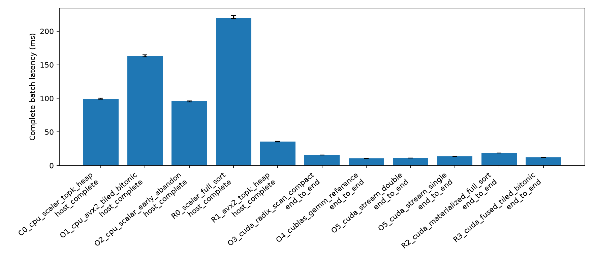
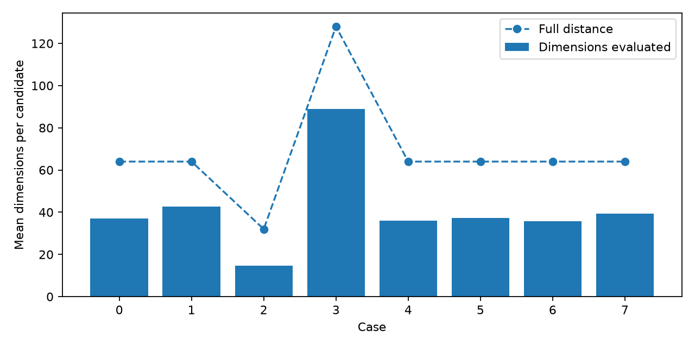
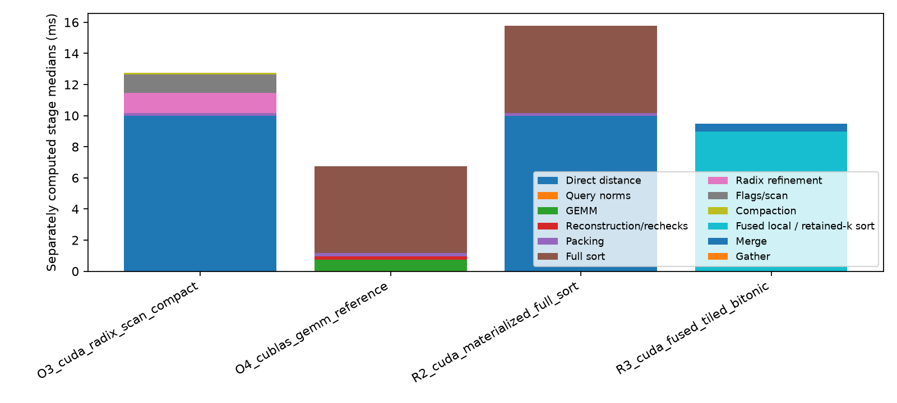
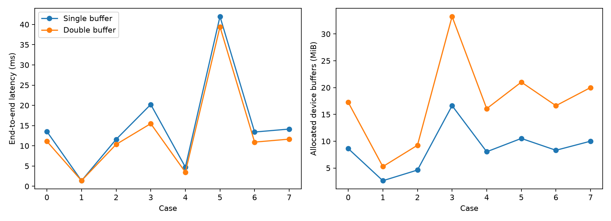

# Optional kNN routes

All recorded configurations passed structural, numerical, deterministic and applicable selection/reference checks.
FP64 ID-position differences: **0** (reported separately from exact FP32 selection).

| Case | Route | Boundary | Median (ms) | IQR/median | Aux/device CPU buffers (MiB) |
|---|---|---|---:|---:|---:|
| 0 | C0_cpu_scalar_topk_heap | host_complete | 99.323 | 1.3% | 0.000 |
| 0 | O1_cpu_avx2_tiled_bitonic | host_complete | 162.804 | 1.7% | 0.132 |
| 0 | O2_cpu_scalar_early_abandon | host_complete | 95.685 | 1.5% | 0.000 |
| 0 | R0_scalar_full_sort | host_complete | 220.057 | 2.0% | 0.763 |
| 0 | R1_avx2_topk_heap | host_complete | 35.635 | 1.8% | 0.000 |
| 0 | O3_cuda_radix_scan_compact | end_to_end | 15.477 | 0.5% | 30.568 |
| 0 | O3_cuda_radix_scan_compact | resident | 12.769 | 0.4% | 30.568 |
| 0 | O4_cublas_gemm_reference | end_to_end | 10.551 | 0.7% | 47.106 |
| 0 | O4_cublas_gemm_reference | resident | 6.770 | 0.4% | 47.106 |
| 0 | O5_cuda_stream_double | end_to_end | 11.108 | 1.4% | 1.251 |
| 0 | O5_cuda_stream_single | end_to_end | 13.532 | 0.7% | 0.626 |
| 0 | R2_cuda_materialized_full_sort | end_to_end | 18.527 | 0.9% | 42.725 |
| 0 | R2_cuda_materialized_full_sort | resident | 15.784 | 0.6% | 42.725 |
| 0 | R3_cuda_fused_tiled_bitonic | end_to_end | 12.212 | 0.9% | 1.909 |
| 0 | R3_cuda_fused_tiled_bitonic | resident | 9.499 | 0.9% | 1.909 |
| 1 | C0_cpu_scalar_topk_heap | host_complete | 9.528 | 0.9% | 0.000 |
| 1 | O1_cpu_avx2_tiled_bitonic | host_complete | 15.680 | 1.6% | 0.014 |
| 1 | O2_cpu_scalar_early_abandon | host_complete | 10.003 | 0.7% | 0.000 |
| 1 | R0_scalar_full_sort | host_complete | 19.194 | 3.2% | 0.076 |
| 1 | R1_avx2_topk_heap | host_complete | 2.616 | 2.2% | 0.000 |
| 1 | O3_cuda_radix_scan_compact | end_to_end | 1.655 | 0.5% | 3.059 |
| 1 | O3_cuda_radix_scan_compact | resident | 1.366 | 0.2% | 3.059 |
| 1 | O4_cublas_gemm_reference | end_to_end | 1.278 | 0.6% | 8.311 |
| 1 | O4_cublas_gemm_reference | resident | 0.878 | 1.0% | 8.311 |
| 1 | O5_cuda_stream_double | end_to_end | 1.390 | 1.5% | 0.387 |
| 1 | O5_cuda_stream_single | end_to_end | 1.375 | 1.4% | 0.194 |
| 1 | R2_cuda_materialized_full_sort | end_to_end | 2.072 | 0.4% | 4.273 |
| 1 | R2_cuda_materialized_full_sort | resident | 1.759 | 0.7% | 4.273 |
| 1 | R3_cuda_fused_tiled_bitonic | end_to_end | 1.294 | 0.7% | 0.193 |
| 1 | R3_cuda_fused_tiled_bitonic | resident | 0.997 | 0.3% | 0.193 |
| 2 | C0_cpu_scalar_topk_heap | host_complete | 63.272 | 0.9% | 0.000 |
| 2 | O1_cpu_avx2_tiled_bitonic | host_complete | 153.896 | 1.3% | 0.132 |
| 2 | O2_cpu_scalar_early_abandon | host_complete | 52.420 | 1.2% | 0.000 |
| 2 | R0_scalar_full_sort | host_complete | 179.430 | 2.0% | 0.763 |
| 2 | R1_avx2_topk_heap | host_complete | 24.073 | 2.0% | 0.000 |
| 2 | O3_cuda_radix_scan_compact | end_to_end | 14.005 | 0.5% | 30.568 |
| 2 | O3_cuda_radix_scan_compact | resident | 12.570 | 0.1% | 30.568 |
| 2 | O4_cublas_gemm_reference | end_to_end | 8.553 | 1.4% | 47.106 |
| 2 | O4_cublas_gemm_reference | resident | 6.595 | 0.5% | 47.106 |
| 2 | O5_cuda_stream_double | end_to_end | 10.353 | 0.3% | 1.251 |
| 2 | O5_cuda_stream_single | end_to_end | 11.602 | 0.5% | 0.626 |
| 2 | R2_cuda_materialized_full_sort | end_to_end | 17.036 | 0.6% | 42.725 |
| 2 | R2_cuda_materialized_full_sort | resident | 15.592 | 0.3% | 42.725 |
| 2 | R3_cuda_fused_tiled_bitonic | end_to_end | 10.950 | 1.0% | 1.909 |
| 2 | R3_cuda_fused_tiled_bitonic | resident | 9.505 | 0.0% | 1.909 |
| 3 | C0_cpu_scalar_topk_heap | host_complete | 218.773 | 1.8% | 0.000 |
| 3 | O1_cpu_avx2_tiled_bitonic | host_complete | 186.894 | 2.0% | 0.132 |
| 3 | O2_cpu_scalar_early_abandon | host_complete | 199.889 | 2.1% | 0.000 |
| 3 | R0_scalar_full_sort | host_complete | 338.895 | 1.6% | 0.763 |
| 3 | R1_avx2_topk_heap | host_complete | 56.418 | 2.3% | 0.000 |
| 3 | O3_cuda_radix_scan_compact | end_to_end | 18.943 | 0.4% | 30.568 |
| 3 | O3_cuda_radix_scan_compact | resident | 13.579 | 0.0% | 30.568 |
| 3 | O4_cublas_gemm_reference | end_to_end | 14.977 | 0.6% | 47.106 |
| 3 | O4_cublas_gemm_reference | resident | 7.203 | 0.5% | 47.106 |
| 3 | O5_cuda_stream_double | end_to_end | 15.489 | 0.3% | 1.251 |
| 3 | O5_cuda_stream_single | end_to_end | 20.225 | 0.6% | 0.626 |
| 3 | R2_cuda_materialized_full_sort | end_to_end | 21.965 | 0.5% | 42.725 |
| 3 | R2_cuda_materialized_full_sort | resident | 16.604 | 0.4% | 42.725 |
| 3 | R3_cuda_fused_tiled_bitonic | end_to_end | 17.506 | 0.3% | 1.909 |
| 3 | R3_cuda_fused_tiled_bitonic | resident | 12.134 | 0.1% | 1.909 |
| 4 | C0_cpu_scalar_topk_heap | host_complete | 6.323 | 1.4% | 0.000 |
| 4 | O1_cpu_avx2_tiled_bitonic | host_complete | 10.244 | 3.2% | 0.132 |
| 4 | O2_cpu_scalar_early_abandon | host_complete | 6.035 | 5.2% | 0.000 |
| 4 | R0_scalar_full_sort | host_complete | 14.182 | 4.7% | 0.763 |
| 4 | R1_avx2_topk_heap | host_complete | 2.164 | 4.0% | 0.000 |
| 4 | O3_cuda_radix_scan_compact | end_to_end | 4.432 | 0.9% | 1.911 |
| 4 | O3_cuda_radix_scan_compact | resident | 1.723 | 0.2% | 1.911 |
| 4 | O4_cublas_gemm_reference | end_to_end | 5.927 | 1.7% | 7.052 |
| 4 | O4_cublas_gemm_reference | resident | 2.106 | 5.2% | 7.052 |
| 4 | O5_cuda_stream_double | end_to_end | 3.486 | 1.0% | 0.078 |
| 4 | O5_cuda_stream_single | end_to_end | 4.739 | 2.2% | 0.039 |
| 4 | R2_cuda_materialized_full_sort | end_to_end | 4.989 | 2.1% | 2.671 |
| 4 | R2_cuda_materialized_full_sort | resident | 2.303 | 4.6% | 2.671 |
| 4 | R3_cuda_fused_tiled_bitonic | end_to_end | 3.390 | 2.0% | 0.119 |
| 4 | R3_cuda_fused_tiled_bitonic | resident | 0.664 | 0.5% | 0.119 |
| 5 | C0_cpu_scalar_topk_heap | host_complete | 400.855 | 2.6% | 0.000 |
| 5 | O1_cpu_avx2_tiled_bitonic | host_complete | 646.258 | 1.9% | 0.132 |
| 5 | O2_cpu_scalar_early_abandon | host_complete | 381.439 | 2.7% | 0.000 |
| 5 | R0_scalar_full_sort | host_complete | 875.505 | 2.2% | 0.763 |
| 5 | R1_avx2_topk_heap | host_complete | 140.026 | 2.7% | 0.000 |
| 5 | O3_cuda_radix_scan_compact | end_to_end | 53.005 | 0.2% | 122.273 |
| 5 | O3_cuda_radix_scan_compact | resident | 50.212 | 0.1% | 122.273 |
| 5 | O4_cublas_gemm_reference | end_to_end | 26.579 | 0.7% | 175.281 |
| 5 | O4_cublas_gemm_reference | resident | 22.638 | 0.4% | 175.281 |
| 5 | O5_cuda_stream_double | end_to_end | 39.424 | 0.2% | 5.005 |
| 5 | O5_cuda_stream_single | end_to_end | 41.973 | 0.3% | 2.505 |
| 5 | R2_cuda_materialized_full_sort | end_to_end | 63.175 | 0.2% | 170.899 |
| 5 | R2_cuda_materialized_full_sort | resident | 60.361 | 0.3% | 170.899 |
| 5 | R3_cuda_fused_tiled_bitonic | end_to_end | 40.591 | 0.1% | 7.637 |
| 5 | R3_cuda_fused_tiled_bitonic | resident | 37.809 | 0.0% | 7.637 |
| 6 | C0_cpu_scalar_topk_heap | host_complete | 102.584 | 0.4% | 0.000 |
| 6 | O1_cpu_avx2_tiled_bitonic | host_complete | 164.640 | 2.1% | 0.073 |
| 6 | O2_cpu_scalar_early_abandon | host_complete | 95.599 | 1.5% | 0.000 |
| 6 | R0_scalar_full_sort | host_complete | 226.057 | 1.1% | 0.763 |
| 6 | R1_avx2_topk_heap | host_complete | 35.846 | 2.6% | 0.000 |
| 6 | O3_cuda_radix_scan_compact | end_to_end | 15.503 | 0.4% | 30.567 |
| 6 | O3_cuda_radix_scan_compact | resident | 12.767 | 0.1% | 30.567 |
| 6 | O4_cublas_gemm_reference | end_to_end | 10.618 | 0.8% | 47.106 |
| 6 | O4_cublas_gemm_reference | resident | 6.782 | 0.7% | 47.106 |
| 6 | O5_cuda_stream_double | end_to_end | 10.920 | 0.3% | 0.626 |
| 6 | O5_cuda_stream_single | end_to_end | 13.413 | 0.6% | 0.313 |
| 6 | R2_cuda_materialized_full_sort | end_to_end | 18.561 | 0.6% | 42.725 |
| 6 | R2_cuda_materialized_full_sort | resident | 15.770 | 0.3% | 42.725 |
| 6 | R3_cuda_fused_tiled_bitonic | end_to_end | 12.084 | 0.6% | 0.955 |
| 6 | R3_cuda_fused_tiled_bitonic | resident | 9.329 | 0.0% | 0.955 |
| 7 | C0_cpu_scalar_topk_heap | host_complete | 103.851 | 1.1% | 0.000 |
| 7 | O1_cpu_avx2_tiled_bitonic | host_complete | 169.275 | 2.6% | 0.395 |
| 7 | O2_cpu_scalar_early_abandon | host_complete | 102.492 | 1.1% | 0.000 |
| 7 | R0_scalar_full_sort | host_complete | 226.812 | 0.8% | 0.763 |
| 7 | R1_avx2_topk_heap | host_complete | 36.348 | 2.4% | 0.000 |
| 7 | O3_cuda_radix_scan_compact | end_to_end | 15.503 | 0.3% | 30.574 |
| 7 | O3_cuda_radix_scan_compact | resident | 12.771 | 0.0% | 30.574 |
| 7 | O4_cublas_gemm_reference | end_to_end | 10.627 | 1.2% | 47.106 |
| 7 | O4_cublas_gemm_reference | resident | 6.784 | 0.5% | 47.106 |
| 7 | O5_cuda_stream_double | end_to_end | 11.656 | 0.3% | 4.004 |
| 7 | O5_cuda_stream_single | end_to_end | 14.145 | 0.2% | 2.004 |
| 7 | R2_cuda_materialized_full_sort | end_to_end | 18.537 | 0.4% | 42.725 |
| 7 | R2_cuda_materialized_full_sort | resident | 15.781 | 0.2% | 42.725 |
| 7 | R3_cuda_fused_tiled_bitonic | end_to_end | 12.784 | 0.3% | 6.109 |
| 7 | R3_cuda_fused_tiled_bitonic | resident | 10.042 | 0.0% | 6.109 |

## Controlled comparisons

The optional benchmark includes fresh R0/R1 CPU and R2/R3 GPU controls plus a scalar full-evaluation heap control unless stream-only mode was requested. Use these controls for comparisons within this run, rather than mixing measurements with older required-run CSVs.

| Case | Optional route | Control | Boundary | Control / optional | Noise flag |
|---|---|---|---|---:|---|
| 0 | O1_cpu_avx2_tiled_bitonic | R1_avx2_topk_heap | host_complete | 0.219x |  |
| 1 | O1_cpu_avx2_tiled_bitonic | R1_avx2_topk_heap | host_complete | 0.167x |  |
| 2 | O1_cpu_avx2_tiled_bitonic | R1_avx2_topk_heap | host_complete | 0.156x |  |
| 3 | O1_cpu_avx2_tiled_bitonic | R1_avx2_topk_heap | host_complete | 0.302x |  |
| 4 | O1_cpu_avx2_tiled_bitonic | R1_avx2_topk_heap | host_complete | 0.211x |  |
| 5 | O1_cpu_avx2_tiled_bitonic | R1_avx2_topk_heap | host_complete | 0.217x |  |
| 6 | O1_cpu_avx2_tiled_bitonic | R1_avx2_topk_heap | host_complete | 0.218x |  |
| 7 | O1_cpu_avx2_tiled_bitonic | R1_avx2_topk_heap | host_complete | 0.215x |  |
| 0 | O2_cpu_scalar_early_abandon | C0_cpu_scalar_topk_heap | host_complete | 1.038x |  |
| 1 | O2_cpu_scalar_early_abandon | C0_cpu_scalar_topk_heap | host_complete | 0.953x |  |
| 2 | O2_cpu_scalar_early_abandon | C0_cpu_scalar_topk_heap | host_complete | 1.207x |  |
| 3 | O2_cpu_scalar_early_abandon | C0_cpu_scalar_topk_heap | host_complete | 1.094x |  |
| 4 | O2_cpu_scalar_early_abandon | C0_cpu_scalar_topk_heap | host_complete | 1.048x |  |
| 5 | O2_cpu_scalar_early_abandon | C0_cpu_scalar_topk_heap | host_complete | 1.051x |  |
| 6 | O2_cpu_scalar_early_abandon | C0_cpu_scalar_topk_heap | host_complete | 1.073x |  |
| 7 | O2_cpu_scalar_early_abandon | C0_cpu_scalar_topk_heap | host_complete | 1.013x |  |
| 0 | O3_cuda_radix_scan_compact | R2_cuda_materialized_full_sort | end_to_end | 1.197x |  |
| 0 | O3_cuda_radix_scan_compact | R2_cuda_materialized_full_sort | resident | 1.236x |  |
| 1 | O3_cuda_radix_scan_compact | R2_cuda_materialized_full_sort | end_to_end | 1.252x |  |
| 1 | O3_cuda_radix_scan_compact | R2_cuda_materialized_full_sort | resident | 1.288x |  |
| 2 | O3_cuda_radix_scan_compact | R2_cuda_materialized_full_sort | end_to_end | 1.216x |  |
| 2 | O3_cuda_radix_scan_compact | R2_cuda_materialized_full_sort | resident | 1.240x |  |
| 3 | O3_cuda_radix_scan_compact | R2_cuda_materialized_full_sort | end_to_end | 1.160x |  |
| 3 | O3_cuda_radix_scan_compact | R2_cuda_materialized_full_sort | resident | 1.223x |  |
| 4 | O3_cuda_radix_scan_compact | R2_cuda_materialized_full_sort | end_to_end | 1.126x |  |
| 4 | O3_cuda_radix_scan_compact | R2_cuda_materialized_full_sort | resident | 1.337x |  |
| 5 | O3_cuda_radix_scan_compact | R2_cuda_materialized_full_sort | end_to_end | 1.192x |  |
| 5 | O3_cuda_radix_scan_compact | R2_cuda_materialized_full_sort | resident | 1.202x |  |
| 6 | O3_cuda_radix_scan_compact | R2_cuda_materialized_full_sort | end_to_end | 1.197x |  |
| 6 | O3_cuda_radix_scan_compact | R2_cuda_materialized_full_sort | resident | 1.235x |  |
| 7 | O3_cuda_radix_scan_compact | R2_cuda_materialized_full_sort | end_to_end | 1.196x |  |
| 7 | O3_cuda_radix_scan_compact | R2_cuda_materialized_full_sort | resident | 1.236x |  |
| 0 | O4_cublas_gemm_reference | R2_cuda_materialized_full_sort | end_to_end | 1.756x |  |
| 0 | O4_cublas_gemm_reference | R2_cuda_materialized_full_sort | resident | 2.332x |  |
| 1 | O4_cublas_gemm_reference | R2_cuda_materialized_full_sort | end_to_end | 1.621x |  |
| 1 | O4_cublas_gemm_reference | R2_cuda_materialized_full_sort | resident | 2.004x |  |
| 2 | O4_cublas_gemm_reference | R2_cuda_materialized_full_sort | end_to_end | 1.992x |  |
| 2 | O4_cublas_gemm_reference | R2_cuda_materialized_full_sort | resident | 2.364x |  |
| 3 | O4_cublas_gemm_reference | R2_cuda_materialized_full_sort | end_to_end | 1.467x |  |
| 3 | O4_cublas_gemm_reference | R2_cuda_materialized_full_sort | resident | 2.305x |  |
| 4 | O4_cublas_gemm_reference | R2_cuda_materialized_full_sort | end_to_end | 0.842x |  |
| 4 | O4_cublas_gemm_reference | R2_cuda_materialized_full_sort | resident | 1.094x |  |
| 5 | O4_cublas_gemm_reference | R2_cuda_materialized_full_sort | end_to_end | 2.377x |  |
| 5 | O4_cublas_gemm_reference | R2_cuda_materialized_full_sort | resident | 2.666x |  |
| 6 | O4_cublas_gemm_reference | R2_cuda_materialized_full_sort | end_to_end | 1.748x |  |
| 6 | O4_cublas_gemm_reference | R2_cuda_materialized_full_sort | resident | 2.325x |  |
| 7 | O4_cublas_gemm_reference | R2_cuda_materialized_full_sort | end_to_end | 1.744x |  |
| 7 | O4_cublas_gemm_reference | R2_cuda_materialized_full_sort | resident | 2.326x |  |
| 0 | O5_cuda_stream_double | O5_cuda_stream_single | end_to_end | 1.218x |  |
| 1 | O5_cuda_stream_double | O5_cuda_stream_single | end_to_end | 0.989x |  |
| 2 | O5_cuda_stream_double | O5_cuda_stream_single | end_to_end | 1.121x |  |
| 3 | O5_cuda_stream_double | O5_cuda_stream_single | end_to_end | 1.306x |  |
| 4 | O5_cuda_stream_double | O5_cuda_stream_single | end_to_end | 1.359x |  |
| 5 | O5_cuda_stream_double | O5_cuda_stream_single | end_to_end | 1.065x |  |
| 6 | O5_cuda_stream_double | O5_cuda_stream_single | end_to_end | 1.228x |  |
| 7 | O5_cuda_stream_double | O5_cuda_stream_single | end_to_end | 1.214x |  |

Ratios above one favour the optional route; ratios below one are retained as measured losses. These are within-run ratios of configuration medians, not paired-sample confidence intervals.

CPU Bitonic uses the same AVX2 distance arithmetic as R1; early abandonment uses exactly R0 scalar arithmetic. Its timing control is C0, a scalar heap with full distance evaluation using the same heap path, so heap selection is held fixed. The early-abandon dimension counter is collected outside timing. Strict partial-sum > threshold pruning preserves ties.

Radix selection refines a deterministic 64-bit threshold over eight 8-bit histogram passes, marks qualifying keys, uses a self-written hierarchical exclusive Blelloch scan and compacts exactly k keys per query. Only the retained k keys are finally Bitonic sorted; there is no full-N sort in this route.

GEMM is a labelled cuBLAS FP32 reference, with query norms, GEMM, reconstruction, packing, full sorting and gathering timed. Resident calls reuse precomputed database norms; end-to-end calls upload X and recompute its norms. Database-norm setup and cuBLAS workspace allocation are disclosed in memory.csv. Near-zero reconstructed distances are re-evaluated directly to guard cancellation, and the recheck count is recorded. GEMM is validated against an independent full sort of its own reconstructed distances; bitwise direct/GEMM equality is not assumed.

Streaming uses bounded pinned host staging and one or two reusable device slots. One compute stream serialises chunk selection and global merging; separate copy streams let the next upload overlap the preceding computation when supported. Candidate IDs retain global offsets and labels are gathered on the host inside end-to-end timing. Streaming always transfers chunks, so it has no resident-only latency. The service-time overlap ratio is an estimate, not a profiler trace.

## Streaming storage and overlap

| Case | Buffers | Chunk rows | Logical inputs (MiB) | Device buffers (MiB) | Pinned host (MiB) | Estimated overlap |
|---|---:|---:|---:|---:|---:|---:|
| 0 | 2 | 32768 | 24.799 | 17.256 | 16.005 | 34.6% |
| 0 | 1 | 32768 | 24.799 | 8.631 | 8.005 | 0.0% |
| 1 | 2 | 10000 | 2.483 | 5.275 | 4.888 | 0.0% |
| 1 | 1 | 10000 | 2.483 | 2.641 | 2.447 | 0.0% |
| 2 | 2 | 32768 | 12.590 | 9.254 | 8.003 | 35.2% |
| 2 | 1 | 32768 | 12.590 | 4.629 | 4.003 | 0.0% |
| 3 | 2 | 32768 | 49.217 | 33.260 | 32.009 | 32.7% |
| 3 | 1 | 32768 | 49.217 | 16.635 | 16.009 | 0.0% |
| 4 | 2 | 32768 | 24.796 | 16.079 | 16.000 | 0.0% |
| 4 | 1 | 32768 | 24.796 | 8.039 | 8.000 | 0.0% |
| 5 | 2 | 32768 | 24.811 | 21.025 | 16.021 | 33.6% |
| 5 | 1 | 32768 | 24.811 | 10.525 | 8.021 | 0.0% |
| 6 | 2 | 32768 | 24.799 | 16.630 | 16.005 | 34.2% |
| 6 | 1 | 32768 | 24.799 | 8.318 | 8.005 | 0.0% |
| 7 | 2 | 32768 | 24.799 | 20.012 | 16.008 | 34.2% |
| 7 | 1 | 32768 | 24.799 | 10.012 | 8.008 | 0.0% |

## Interpretation

A small chunk-budget experiment validates bounded-memory processing; it is not evidence that the tested database exceeded physical GPU memory unless its recorded size actually did. Double buffering can lose on small inputs. The host input must fit host RAM. Actual device buffer allocation is not a DRAM-traffic measurement. All noisy groups remain retained; session repeatability and generalisation require additional evidence.

