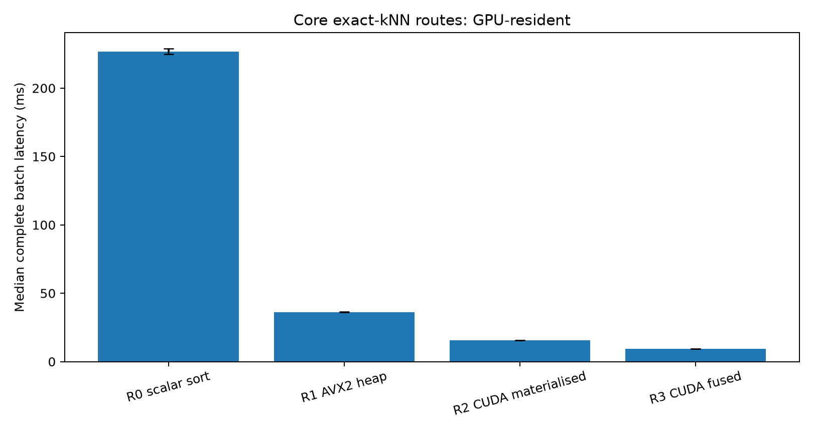
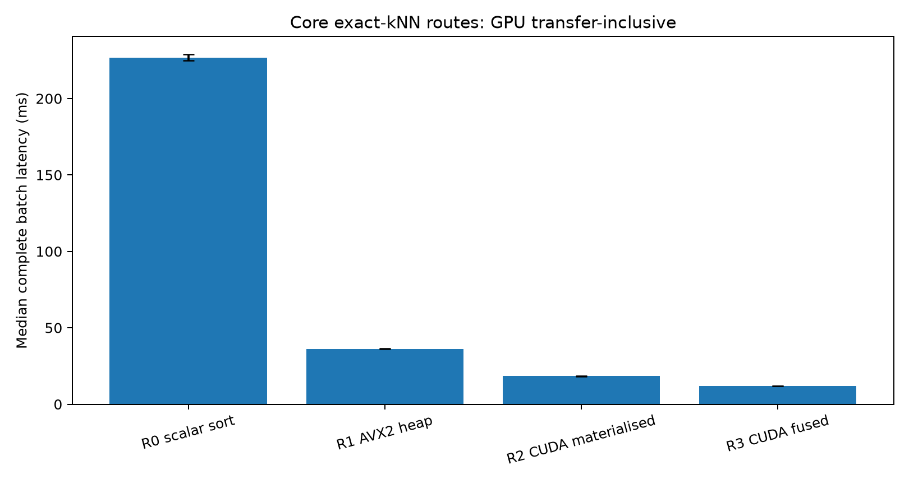
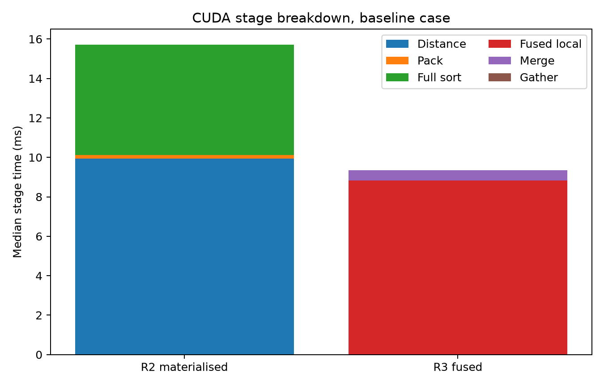
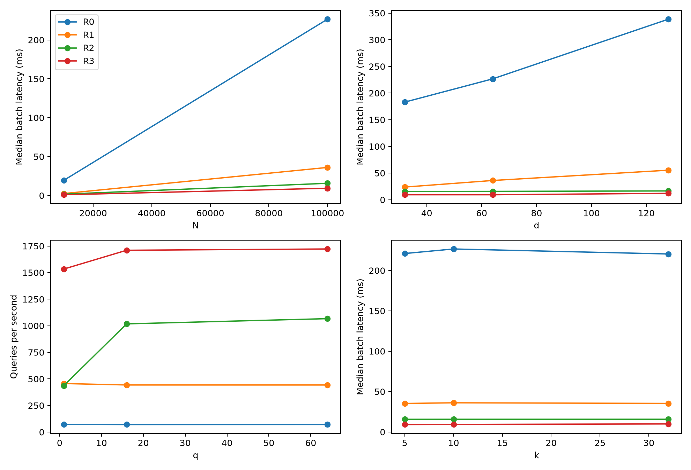
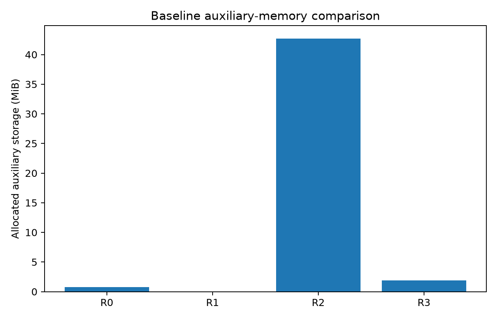
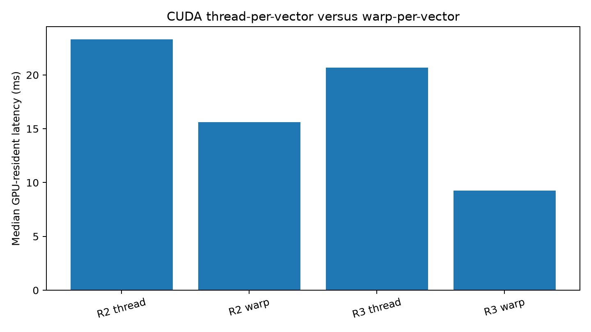
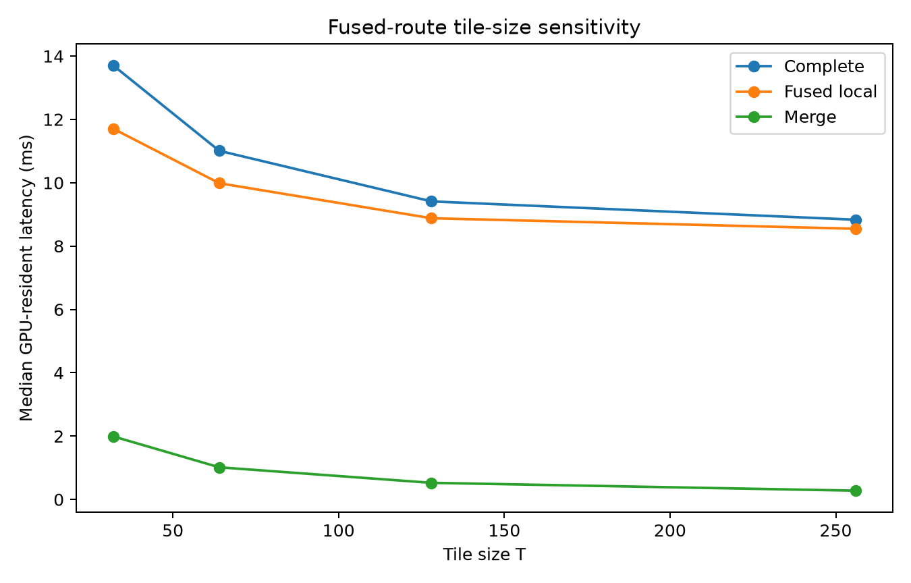
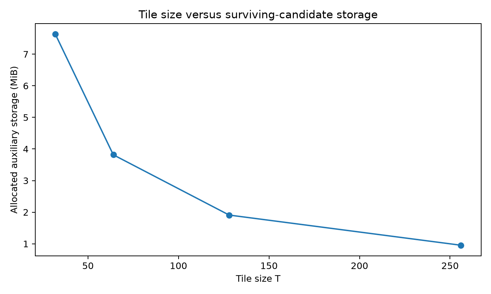

# Exact-kNN CPU/CUDA Experiment Results

## Experimental contract

All implementations examine every database vector and return exactly `k`
query-major results ordered by ascending computed FP32 squared-L2 distance and then ascending
sample ID. R0 is the scalar CPU full-sort baseline, R1 combines AVX2 distance
computation with a Top-k max-heap, R2 materialises and fully sorts the CUDA
distance table, and R3 fuses tiled distance computation with local Bitonic
selection and hierarchical candidate merging.

The primary CUDA configuration uses `warp_per_vector` and `T =
128`. The mapping was selected by the separate baseline R3 resident ablation. Reusable buffers are preallocated.
CPU routes use ten warm-ups and twenty measured calls per retained group. GPU groups contain 20 samples; GPU warm-ups are 10. The predeclared CPU group 0 supplies headline comparisons; any additional groups remain retained. The environment identifies whether this is a smoke run.

## Algorithm and storage model

For C=ceil(N/T) and P=next_power_of_two(k), all required routes perform
O(qNd) distance work. R0 fully sorts N candidates per query; R1 retains a
max-heap and finally orders its k outputs. R2 uses CUB full radix sorting
of packed 64-bit keys, not a custom radix-selection implementation.

| Route | Selection work | Principal temporary storage |
|---|---|---|
| R0 | O(qN log N) comparison sorting | O(N) candidates reused per query |
| R1 | O(qN log k), plus final O(qk log k) | O(k) candidates |
| R2 | Full segmented radix sorting of fixed-width keys | 20qN + 4(q+1) + S_CUB bytes |
| R3 local | O(qCT log²T) local Bitonic sorting | Two candidate buffers: 16qCk bytes |
| R3 merge | O(q(C−1)P log²(2P)) for the implemented padded pair sorting | ceil(log2 C) merge levels |

Local pruning is exact under the declared total order: a candidate beyond a
tile's local Top-k already has at least k candidates ahead of it in that tile.
It therefore cannot enter global Top-k. Repeated correct Top-k reductions of
the candidate unions preserve that result. The unit tests compare the merge
with concatenation and full sorting, including ties and odd list counts.

## Correctness

All required correctness records passed. Across CPU and GPU outputs, the
records report **0** FP64 Top-k position differences and a maximum
absolute distance error of **7.85854889e-05**. CPU error records include all
candidate distances; GPU error records cover the returned Top-k. FP64 ID agreement is
reported separately from FP32 route-specific selection. The fused route had
**0** failures against the same-mapping materialised full-sort
result. Repeated-call determinism, labels, output ordering, finite non-negative
distances and the stated absolute-plus-relative tolerance were all required
before timing data entered the analysis.

Exact selection is defined under each route's documented FP32 accumulation
order. Near ties can change FP64 neighbour ordering after FP32 rounding;
universal FP64 ID equality is not implied by passing distance tolerance.
The numerical criterion is `abs(d32-d64) <= 1e-5 + 1e-4*abs(d64)`.

## Baseline performance and storage

| Route | Timing boundary | Median latency (ms) | Auxiliary storage (MiB) |
|---|---|---:|---:|
| R0 scalar full sort | CPU complete | 226.650 | 0.763 |
| R1 AVX2 Top-k heap | CPU complete | 36.115 | 0.000 |
| R2 materialised CUDA | GPU resident | 15.720 | 42.725 |
| R3 fused CUDA | GPU resident | 9.355 | 1.909 |
| R2 materialised CUDA | End-to-end | 18.390 | 42.725 |
| R3 fused CUDA | End-to-end | 12.034 | 1.909 |

For the baseline workload, R1 achieved **6.276x**
over R0. Relative to R2, the fused R3 route achieved
**1.680x** in GPU-resident timing and
**1.528x** when transfers were
included. These ratios describe the recorded machine and fixed inputs; they are
not hardware-independent peak-performance claims.

No baseline group exceeded 10% IQR/median in this session; separate sessions still test repeatability.

The R0/R1 comparison combines SIMD arithmetic and heap selection. It does not
isolate the SIMD contribution. R2 allocated 42.725 MiB of auxiliary device buffers; R3 allocated 1.909 MiB (22.38x less). R2 includes distances, two packed-key buffers, offsets and CUB scratch. R3 includes both candidate buffers. Inputs, outputs and dynamic shared memory are recorded separately. These allocations do not measure DRAM traffic.

## CUDA stage behaviour

R2 separately records distance computation, deterministic key packing,
segmented full sorting and final gathering. R3 records one combined fused-local
stage because distance computation and local Bitonic selection occur in the
same kernel; inventing separate values would require changing the algorithm.
Hierarchical merge and final gathering remain separate stages.

At the core baseline, R2 distance and full-sort medians were 9.928 and 5.583 ms. R3 fused-local and merge medians were 8.825 and 0.522 ms. Stage medians are computed separately and need not sum to the complete median.

## Workload sensitivity

The one-factor-at-a-time grid changes database size, dimension, query batch and
returned `k` while holding the remaining baseline values fixed. This allows the
report to attribute each crossover to one workload factor instead of a large,
confounded Cartesian product. A crossover is claimed only within the measured
grid; an automated backend policy and unmeasured thresholds are not claimed.

The following comparison includes GPU transfers. Its fastest route is selected
from the measured CPU complete and GPU end-to-end medians, with variability
flags retained below.

| Case | N / d / q / k | R0 (ms) | R1 (ms) | R2 end-to-end (ms) | R3 end-to-end (ms) | Lowest measured median |
|---|---|---:|---:|---:|---:|---|
| 0 | 100000 / 64 / 16 / 10 | 226.650 | 36.115 | 18.390 | 12.034 | R3 |
| 1 | 10000 / 64 / 16 / 10 | 19.532 | 2.541 | 2.039 | 1.265 | R3 |
| 2 | 100000 / 32 / 16 / 10 | 183.092 | 23.773 | 16.897 | 10.743 | R3 |
| 3 | 100000 / 128 / 16 / 10 | 338.613 | 55.410 | 21.903 | 17.384 | R3 |
| 4 | 100000 / 64 / 1 / 10 | 13.792 | 2.191 | 4.902 | 3.289 | R1 |
| 5 | 100000 / 64 / 64 / 10 | 899.713 | 144.521 | 62.817 | 39.927 | R3 |
| 6 | 100000 / 64 / 16 / 5 | 221.032 | 35.317 | 18.410 | 11.918 | R3 |
| 7 | 100000 / 64 / 16 / 32 | 220.454 | 35.380 | 18.511 | 12.667 | R3 |

## Mapping ablation

| Route | Mapping | Median resident latency (ms) |
|---|---|---:|
| R2 | thread_per_vector | 23.305 |
| R2 | warp_per_vector | 15.598 |
| R3 | thread_per_vector | 20.668 |
| R3 | warp_per_vector | 9.272 |

## Tile-size sensitivity

| T | Complete (ms) | Fused local (ms) | Merge (ms) | Auxiliary MiB | Merge levels |
|---:|---:|---:|---:|---:|---:|
| 32 | 13.705 | 11.707 | 1.992 | 7.629 | 12 |
| 64 | 11.009 | 9.986 | 1.016 | 3.816 | 11 |
| 128 | 9.412 | 8.879 | 0.525 | 1.909 | 10 |
| 256 | 8.833 | 8.547 | 0.278 | 0.955 | 9 |

Among the measured tiles, T=256 had the lowest resident median (8.833 ms). From T=32 to T=256, allocated candidate storage changed from 7.629 to 0.955 MiB and merge depth changed from 12 to 9 levels. The measured fused-local medians were 11.707 and 8.547 ms; merge medians were 1.992 and 0.278 ms. The predefined T=128 reference measured 9.412 ms in this ablation. Larger tiles produce fewer candidate lists, while their local sorting networks are larger. The fastest measured tile is specific to this baseline, mapping and machine; the required core grid retains its predefined reference tile.

## Variability and limitations

There were **1 CPU** and **0 GPU** summary groups
with IQR/median above 10%. All groups remain in the raw records.

| Backend | Source | Case | Route | CPU group | Mode | Mapping / tile | IQR/median |
|---|---|---|---|---|---|---|---:|
| CPU | cpu | 5 | R1 | 0 | host_complete |  /  | 15.2% |

This single session does not establish between-session repeatability or
confidence intervals. Use the repeated-study summary when separate sessions
have completed. Synthetic inputs and this GPU/CPU limit generalisation.
Source hashes and the available Git revision are captured in the environment;
an unavailable Git revision is not described as a reviewed commit.

The materialised route uses CUB only for its labelled full-sort stage;
all required distance kernels, fused local Bitonic selection and hierarchical
candidate merging are self-written. The experiment targets exact search and
does not compare HNSW, IVF, product quantisation, multi-GPU execution or neural
network training.

Optional CPU Bitonic, custom Radix Select, GEMM-based L2, early abandonment and
out-of-core double buffering should be reported only if implemented after this
required experiment is frozen and reproduced.
